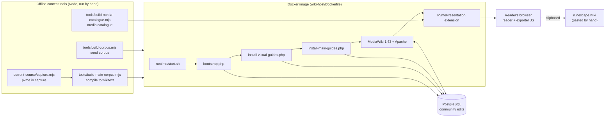

# PvME Wiki

PvME Wiki is a MediaWiki site that hosts the RuneScape 3 bossing guides published by
PvME (pvme.io) as editable wiki pages, with attribution. It is served at
`https://pvmewiki.sanji3.dev`. Each guide page also has a **Copy to wiki** button that
converts the page's latest saved revision into wikitext for RuneScape Wiki
(runescape.wiki).

Everything described here lives in `wiki-host/`. The rest of the repository is an
earlier reader prototype and is not part of this system.

## The pieces

- **Container runtime**: three PHP scripts that run before Apache starts. They install
  MediaWiki into an empty database and import a fixed seed corpus, or confirm an
  earlier install, then publish packaged pages without overwriting community edits.
  See [Container startup](Container-startup).
- **PvmePresentation**: a MediaWiki extension. It renders guide media tags, sets guide
  headings, and loads the browser code. See [Architecture](Architecture).
- **Reader**: browser code that adds navigation, attribution and the Copy to wiki
  button around a guide. It never changes the saved article. See [Reader](Reader).
- **Exporter**: a pure function that turns a saved revision into RuneScape Wiki
  wikitext and refuses anything it cannot reproduce exactly. See
  [Export to RuneScape Wiki](Export-to-RuneScape-Wiki).
- **Content tools**: Node scripts that capture pvme.io, compile guides to wikitext and
  build the data files the image ships. See [Content pipeline](Content-pipeline).

## Where to go next

| If you want to | Read |
| --- | --- |
| understand how the parts fit | [Architecture](Architecture) |
| know what happens when the container starts | [Container startup](Container-startup) |
| build, deploy, roll back or back up | [Deployment](Deployment) |
| change what the browser shows | [Reader](Reader) |
| change the RuneScape Wiki export | [Export to RuneScape Wiki](Export-to-RuneScape-Wiki) |
| update guide content | [Content pipeline](Content-pipeline) |
| run the tests | [Testing](Testing) |
| know what is imperfect | [Known limitations](Known-limitations) |

## Conventions in these pages

File paths are written from the repository root, for example
`wiki-host/runtime/bootstrap.php`. Commands say which directory to run them from.
These pages are plain Markdown so they can also be published as the repository's
GitHub wiki.
